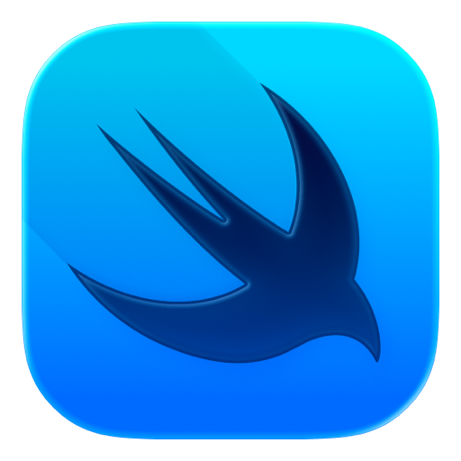

# 👋 Hi, I'm ENG Douglas Oroko

**Software Developer | UI/UX Designer | Web & Mobile Application Developer**

I'm a passionate software developer focused on designing and building modern, scalable, and user-friendly applications. I enjoy turning ideas into practical digital experiences through thoughtful UI/UX design, frontend engineering, backend development, and cross-platform technologies.

---

## 🛠️ My Tech Stack

<table >
  <tr>
    <td >
      
    </td>
    <td >
      
    </td>
    <td >
      
    </td>
        <td >
      
    </td>
    <td >
      
    </td>
    <td >
      
    </td>
    <td >
      
    </td>
   <td >
      
    </td>
  </tr>
    <tr>
    <td >
      Flutter
    </td>
    <td >
      Dart
    </td>
    <td >
      SwiftUI
    </td>
    <td>
      React
    </td>
    <td >
      SQL
    </td>
    <td >
      Node.js
    </td>
    <td >
      GitHub
    </td>
    <td>
      TypeScript
    </td>
</table>

<!--  -->

---

## 📊 GitHub Statistics

  

---

## 🔥 GitHub Contribution Streak

  

